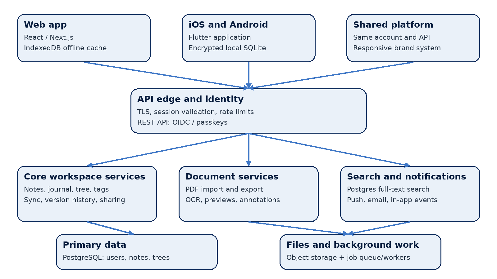

# Qvill System Design

A cross-platform workspace for notes, journals, knowledge bases and PDFs

Product and technical architecture | 26 October 2026

## Executive summary

Qvill brings quick capture, daily journaling, structured knowledge bases and PDF workflows into one personal workspace. The recommended design uses native-feeling iOS and Android clients, a responsive web client, and a shared API. Each client stores work locally for fast entry and offline access; a versioned sync service reconciles changes with a modular backend. PostgreSQL is the system of record, while object storage holds PDFs, exports and note attachments.

Start with a modular monolith and a focused first release. This keeps the product easier to build and operate while preserving clear boundaries for notes, journals, hierarchy, search, sync and document processing. Treat imported PDFs as source documents that can be annotated or converted into editable Qvill content; keep the original unchanged so the user can always return to it.

### Design decisions at a glance

| **Decision** | **Recommendation** |
| --- | --- |
| Clients | Flutter for iOS and Android; React/Next.js for web; shared API and data contracts. |
| Backend | Modular monolith with REST endpoints, background workers and explicit service boundaries. |
| Storage | PostgreSQL for structured data; object storage for PDFs and attachments; local encrypted databases for offline work. |
| Editor | Structured rich-text document model with Markdown import/export and platform-neutral rendering. |
| PDF editing | Annotations and text extraction in the first release; preserve source PDF; offer conversion to an editable Qvill note. |

## 1. Product scope and experience

Qvill is organized around the way a person thinks: capture a thought immediately, add a dated journal entry, or develop information into a navigable knowledge base. The same content can be searched, linked, exported and shared from phone or web.

| **Area** | **User capabilities** | **Key design detail** |
| --- | --- | --- |
| Quick notes | Create a note from anywhere; title, body, tags, pin, archive, link and search. | Fast capture with autosave and no required folder. |
| Daily journal | One entry per date by default; calendar and timeline views; prompts and private entries. | Entries are date-addressable and remain editable. |
| Knowledge base | Nested notebooks and pages; reorder, move, link, tag and search. | Tree structure with stable IDs; links use IDs, not titles. |
| PDF workspace | Import, preview, annotate, extract text, convert and export/share. | Original file is preserved; edits are versioned overlays or converted note content. |
| Cross-device access | Web, iPhone and Android; offline editing and sync. | Conflict states are visible and recoverable. |

### Primary navigation

- Home / Inbox: recent notes, quick capture, pinned items and items awaiting review.

- Journal: daily entries organized by date with calendar and search views.

- Knowledge: notebooks and nested pages in a collapsible tree, with backlinks and breadcrumbs.

- PDFs: imported originals, annotations, converted notes and exports.

- Search: global search across titles, body text, tags, journal entries and extracted PDF text.

### Qvill visual identity

Use the current Qvill direction as a product design anchor: a deep navy field, a clear open Q, and a prominent white feather quill with visible barbs and a nib. Apply navy to navigation, primary actions and app icon surfaces; use white and cool paper tones for reading surfaces. Reserve a restrained blue accent for links, selection and focus states. The generated mark is a concept image; create a clean vector master and small-size optical variants before production.

| **Token** | **Suggested use** | **Value** |
| --- | --- | --- |
| Qvill Navy | Brand surfaces, navigation, primary action | #092859 |
| Quill White | Quill mark, contrast on navy, page surface | #FFFFFF |
| Link Blue | Links, focus ring, selected controls | #3D76C6 |
| Paper | Main light-mode canvas | #F5F8FC |
| Ink | Body text and icons | #263445 |

## 2. Platform and system architecture

The client applications share identity, APIs, note formats and sync semantics. Each keeps a local database and a pending-change queue. The API validates access and writes canonical changes. PDF conversion, previews and OCR run asynchronously so large documents do not block note editing.

*Figure 1. Qvill logical architecture*

### Application boundaries

| **Component** | **Responsibilities** |
| --- | --- |
| Web client | Responsive editor, tree navigation, PDF workspace, IndexedDB cache, browser file access. |
| iOS and Android clients | Quick capture, journal, tree, local SQLite, secure storage, native share sheet and push notifications. |
| API edge and identity | TLS termination, authentication, rate limits, tenant isolation and API versioning. |
| Workspace modules | Notes, journals, hierarchy, tags, links, sharing, version history and sync cursor handling. |
| Document pipeline | Upload validation, malware scan, page thumbnails, OCR/text extraction, PDF export and job status. |
| Data services | PostgreSQL, object storage, job queue, observability and backups. |

### Recommended implementation stack

- Mobile: Flutter with platform-specific adapters for file pickers, secure storage, share sheets, notifications and background uploads.

- Web: React with Next.js; a structured editor based on ProseMirror/Tiptap; IndexedDB for offline note cache and queued operations.

- Backend: TypeScript or Kotlin service in a modular monolith; REST/JSON APIs; OpenAPI contracts; worker process for asynchronous jobs.

- Data: PostgreSQL for users and content; S3-compatible object storage for source PDFs and exports; Redis or managed queue for job coordination; PostgreSQL full-text search for the initial release.

- Operations: centralized logs, metrics, traces, database backups, object lifecycle policies, feature flags and staged releases.

## 3. Data model and synchronization

Use stable UUIDs for user-owned objects. Store editor content in a versioned JSON schema so web and mobile can render the same document. Keep a plain-text projection for indexing and a Markdown conversion path for portability. Never make the display title the key for a notebook, page or link.

| **Entity** | **Important fields** | **Notes** |
| --- | --- | --- |
| User | id, email, auth_provider, preferences, created_at | Identity and account settings. |
| Workspace | id, owner_id, name, encryption_state | Personal space in v1; collaboration-ready boundary. |
| Note | id, workspace_id, kind, title, body_json, plain_text, parent_id, position, created_at, updated_at, version | kind supports quick, journal, knowledge and converted-PDF notes. |
| JournalEntry | note_id, entry_date, timezone, mood / prompts (optional) | Unique on workspace and local date if one-entry-per-day is enabled. |
| Tag / NoteTag | tag_id, note_id | Many-to-many labels; user-scoped names. |
| Link | source_note_id, target_note_id, anchor / label | Backlinks and cross-references by stable IDs. |
| Attachment | id, note_id, object_key, mime_type, checksum, size_bytes | Original PDF, embedded media or export. |
| PdfAsset | attachment_id, page_count, extracted_text, processing_state | Processing results and searchable text; source remains immutable. |
| Revision | object_id, version, content_snapshot, actor_id, created_at | Recovery, history and conflict resolution. |

### Offline-first sync flow

1. Write locally first and assign a client operation ID. Autosave updates the local revision and queues an operation.

1. When connected, send queued operations with the last known server version and sync cursor.

1. The API validates ownership, applies non-conflicting changes, records a revision and returns the canonical version and cursor.

1. For simultaneous edits, preserve both versions. Merge independent metadata changes automatically; show a recoverable conflict for overlapping text edits.

1. Use tombstones for deletions until all active devices have acknowledged the delete or the retention period expires.

Conflict policy: never silently discard user text. For v1, use per-note optimistic concurrency with revision history. A later release can add character-level collaborative editing if live co-editing becomes a product requirement.

### Example API surface

| **Method and route** | **Purpose** |
| --- | --- |
| POST /v1/notes | Create a quick note or knowledge page. |
| PATCH /v1/notes/{id} | Update body, title, tags or parent with base version. |
| GET /v1/sync?cursor={cursor} | Fetch server changes since a device cursor. |
| POST /v1/sync/operations | Submit queued local operations. |
| POST /v1/files/presign | Request a scoped upload URL for a PDF or attachment. |
| POST /v1/pdfs/{id}/jobs | Request OCR, thumbnail generation, conversion or export. |

## 4. PDF import, editing and export

PDF support spans two different jobs: changing the PDF itself and reusing its information inside Qvill. The first release should make both paths clear and preserve the imported original.

| **Workflow** | **First-release behavior** | **Later enhancement** |
| --- | --- | --- |
| Import | Upload PDF; validate type and size; scan; store immutable original; generate page previews and extracted text. | Batch import, OCR language selection, larger file support. |
| Annotate | Add highlights, comments, freehand marks and bookmarks as a versioned annotation layer. | More annotation tools and annotation collaboration. |
| Edit content | Offer “Convert to editable note” using extracted text and images; user edits Qvill content while original remains intact. | Advanced PDF text/object editing with layout preservation. |
| Export | Render note/journal/knowledge page to a paginated PDF; include title, date, page numbers and attachments as configured. | Templates, table of contents, custom page themes and batch export. |
| Share | Use native share sheet or secure expiring link with scope and expiry controls. | Shared workspaces and recipient collaboration. |

### Import pipeline

- Client requests a scoped upload URL and streams the file directly to object storage; API does not proxy large file bytes.

- A worker validates MIME type and file signature, checks size/page limits, scans for malware, calculates a checksum, then creates thumbnails and extracts text/OCR.

- The user sees processing status and can open the source PDF immediately; extracted text and pages become searchable when processing completes.

- PDF page and annotation coordinates are stored in a stable page coordinate system so overlays remain aligned across screen sizes.

### Export pipeline

- The editor serializes structured content into a print layout, embeds permitted images and fonts, and sends an export job to a worker.

- The worker produces a PDF, stores it as an attachment, records a checksum and completion status, and returns a time-limited download link.

- Sharing requires an explicit choice of file download, operating-system share sheet or expiring link; private notes do not become public by default.

## 5. Security, privacy and quality attributes

| **Area** | **Design requirement** |
| --- | --- |
| Authentication | Use OIDC-compatible sign-in; support passkeys where available; short-lived access tokens and refresh-token rotation. |
| Authorization | Every API query scopes objects by workspace and owner; verify access on every read, write, share and download. |
| Transport and storage | TLS in transit; encrypted databases, backups and object storage; managed keys and rotation. |
| Device security | Use OS secure storage for credentials; encrypt local note databases; support remote session revocation. |
| PDF safety | Validate signature and MIME type, enforce size/page limits, scan uploads, isolate converters and avoid executing embedded content. |
| Privacy controls | Export all user data; delete account and associated files; make link access revocable and time-limited. |
| Observability | Record operational events without logging note bodies, journal text, extracted PDF contents or access tokens. |

### Initial service goals

| **Quality attribute** | **Initial target** |
| --- | --- |
| Quick capture | Open capture and commit locally in under 300 ms on a typical supported device. |
| Sync | 95% of queued text changes reach the server within 5 seconds on a stable connection. |
| Availability | 99.9% monthly API availability after launch readiness and monitoring are established. |
| Search | Return common workspace searches in under 1 second at the 95th percentile for typical accounts. |
| PDF processing | Show job progress; target first-page preview within 10 seconds for ordinary PDFs, excluding unusually large or scanned documents. |
| Recovery | Daily database backups, point-in-time recovery, object versioning or equivalent protection for source files. |

## 6. Delivery plan and open decisions

| **Phase** | **Scope** | **Exit criteria** |
| --- | --- | --- |
| Foundation | Authentication, workspace, quick notes, editor, local cache, sync and core brand components. | Notes work offline and recover cleanly after sync conflicts. |
| Journal and knowledge base | Daily entries, calendar, nested tree, reorder, tags, links, search and revision history. | Users can capture and retrieve content through all three note modes. |
| PDF workflows | Import, previews, OCR/text search, annotations, convert-to-note, PDF export and share sheet. | Original remains recoverable; exported PDFs match preview and render tests. |
| Hardening and launch | Accessibility, privacy controls, performance, backups, analytics with content privacy, store readiness. | Operational runbooks, alerting, support flows and release checklist complete. |

### Decisions to confirm before implementation

- Whether Qvill is single-user only at launch or needs shared notebooks and collaboration in the first release.

- Whether user-defined or end-to-end encryption is a launch requirement, plus account recovery and deleted-content retention; these choices affect search, sync and PDF processing.

- Maximum PDF size/page count, OCR languages, offline annotations, journal privacy controls, and editor/export fidelity for rich text, tables, images and attachments.
